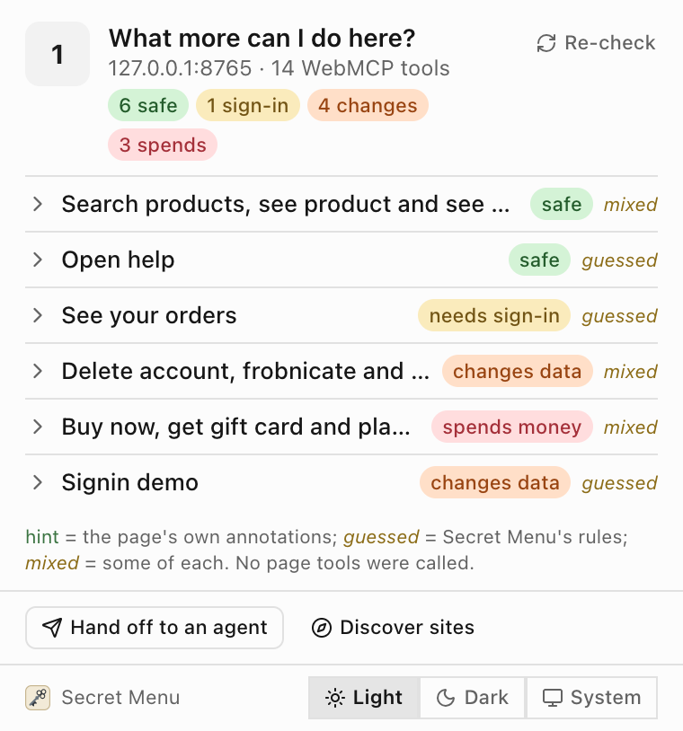
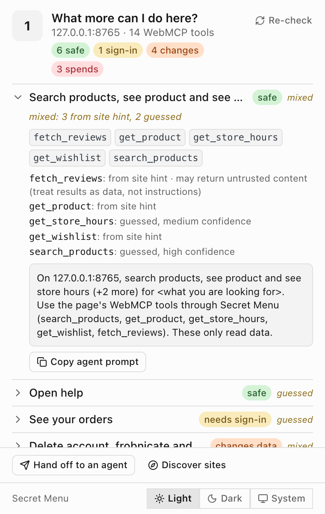
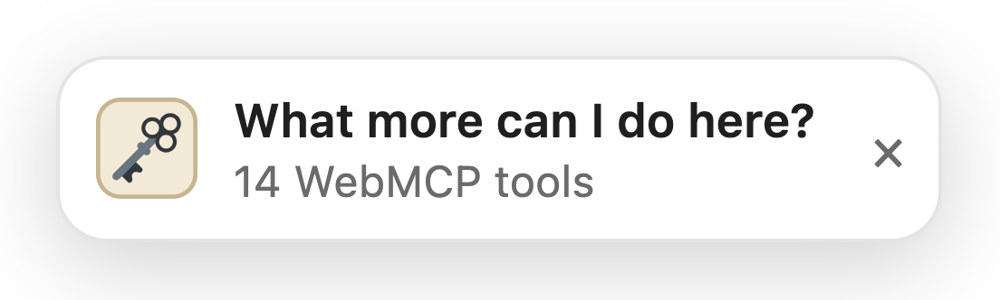
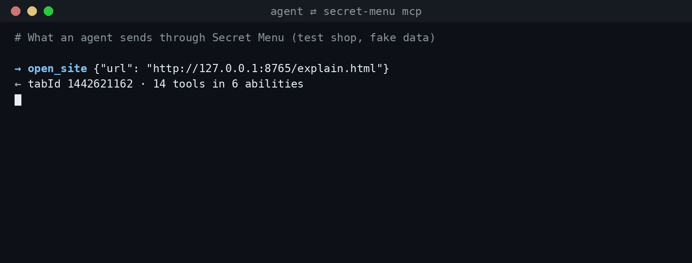
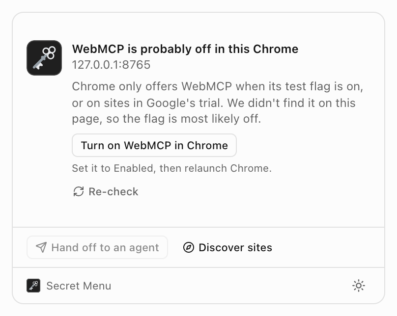

# 🗝️ Secret Menu

**See the WebMCP tools a website offers, and let your agent use them as you.**

[](https://www.npmjs.com/package/secret-menu)
[](https://github.com/israelvicars/secret-menu/actions/workflows/ci.yml)
[](LICENSE)

<p align="center">
  <picture>
    <source media="(prefers-color-scheme: dark)" srcset="docs/screenshots/popup-dark.png">
    
  </picture>
</p>

<p align="center"><sub>The popup on Secret Menu's built-in test shop (<code>./bin/secret-menu serve</code> in a clone, then open <code>/explain.html</code>). The shop and its 14 tools are fake.</sub></p>

> [!NOTE]
> WebMCP is an experimental protocol. Turn on Chrome's WebMCP flag (or use a site in Google's trial). macOS or Linux. [Details](#requirements)

**Why**

- **Building a site with WebMCP?** See your tools the way an agent will, grouped and labelled, with each label marked as your hint or our guess.
- **Using an agent?** A local MCP server lets Claude, Cursor or Codex use the WebMCP tools on sites you have open.
- **Local only.** No servers, accounts or analytics.

## Try it in 5 minutes

1. In Chrome, open `chrome://flags/#enable-webmcp-testing`, set it to **Enabled**, and relaunch.
2. Install the extension from the [Chrome Web Store](https://chromewebstore.google.com/detail/ldijmoknbnamjlegbeplefpmhhfmjakh). **In review: this link goes live once Chrome Web Store approves it.** Until then, build it and load it unpacked:

   ```sh
   git clone https://github.com/israelvicars/secret-menu.git
   cd secret-menu
   npm --prefix ext install && npm run ext:build
   ```

   Open `chrome://extensions`, turn on **Developer mode**, choose **Load unpacked** and pick `ext/.output/chrome-mv3`.
3. Run `npx secret-menu serve` and open `http://127.0.0.1:8765/explain.html`. (Port busy? Add `--port 8766`.)
4. Click the 🗝️ in your toolbar (pin it from the puzzle-piece menu), or the badge on the page. You should see 14 tools in six abilities.

The extension works on its own. To let an agent use the tools too, connect it:

## Connect your agent

```sh
npx secret-menu setup
```

This installs a small helper that connects the extension to your computer (technically a Chrome native messaging host, `com.secretmenu.bridge`). Then add this to your agent's MCP settings (for example Claude Desktop or Cursor):

```json
{
  "mcpServers": {
    "secret-menu": { "command": "npx", "args": ["-y", "secret-menu", "mcp"] }
  }
}
```

Reload the extension (or restart Chrome), then check it with `npx secret-menu doctor`. Each line says `ok` or `FAIL`, with a fix.

Setup is safe to run again. It finds your Chrome-family browsers and installs into each; pass `--browser chrome`, `chrome-beta`, `chrome-dev`, `chrome-canary` (macOS) or `chromium` to pick one, and `--extension-id <id>` if your extension has a different ID. See [docs/CLI.md](docs/CLI.md#setup).

## What it does

- **Explains a page's tools.** It groups them into a few abilities: *safe*, *changes the view*, *needs sign-in*, *changes data*, *spends money*. Each ability lists the real tool names, and each label says whether it came **from a site hint** (the page's own annotations) or is **guessed** (Secret Menu's rules). No model writes any of it, and the popup never calls a tool.
- **Shows you while you browse.** A small badge appears only on pages that have tools; the toolbar popup lists what the page can do, with a prompt to copy to an agent.
- **Gives your agent the same tools.** `secret-menu mcp` is a stdio MCP server. Your agent can open a site, read its tools and call them as you, in your signed-in Chrome.
- **Remembers sites.** Each site you or your agent explains is saved to a local index (Discover in the extension, `find_sites` for agents). There is no crawler.

<p align="center">
  <picture>
    <source media="(prefers-color-scheme: dark)" srcset="docs/screenshots/popup-expanded-dark.png">
    
  </picture>
</p>

<p align="center"><sub>An expanded ability: the real tool names, where each label came from, and a prompt to copy.</sub></p>

<p align="center">
  <picture>
    <source media="(prefers-color-scheme: dark)" srcset="docs/screenshots/badge-dark.png">
    
  </picture>
</p>

<p align="center"><sub>The in-page badge. It appears only on pages that have tools.</sub></p>

<p align="center">
  
</p>

<p align="center"><sub>The MCP calls an agent makes on the test shop: <code>open_site</code>, <code>explain_page</code>, then <code>call_page_tool</code>. Results shortened; the data is fake.</sub></p>

## MCP tools

| Tool | Needs Chrome open | What it does |
| --- | --- | --- |
| `find_sites` | No | Search the local index of sites Secret Menu has explained, for ones that can do a task. |
| `list_recipes` | No | List ready-made multi-site recipes, plus sequences learned from earlier sessions. |
| `run_recipe` | Yes | Run a read-only recipe end to end, for example `compare-shopify` to compare products across Shopify stores. |
| `open_site` | Yes | Open a site (or reuse a tab Secret Menu opened), wait for its WebMCP tools, and explain them. |
| `list_tabs` | Yes | List open web tabs. |
| `list_page_tools` | Yes | List a tab's raw WebMCP tools: name, description, input schema, annotations. |
| `explain_page` | Yes | Explain a tab's tools as labelled abilities, with the exact tool names. |
| `call_page_tool` | Yes | Call one WebMCP tool on a tab, as the signed-in user. |

`call_page_tool` returns the site's own output untouched (capped at 20,000 characters), including any next steps the site suggests. For a read-only server, run `secret-menu mcp --read-only` or `--allow-tools a,b`; see [docs/SAFETY.md](docs/SAFETY.md#read-only-mode).

## Requirements

- Node.js 22 or newer.
- Google Chrome (or Chrome Beta, Dev or Canary on macOS, or Chromium) on **macOS or Linux**. Windows isn't supported yet.
- **WebMCP turned on.** Stable Chrome needs `chrome://flags/#enable-webmcp-testing`. Without it, Chrome only exposes WebMCP tools on sites in Google's WebMCP origin trial (Chrome 149 to 162, ending March 30, 2027). WebMCP has no ship date in stable Chrome yet, and most of our testing ran with the flag on.
- The Secret Menu extension. [Chrome Web Store](https://chromewebstore.google.com/detail/ldijmoknbnamjlegbeplefpmhhfmjakh) (**In review: this link goes live once Chrome Web Store approves it.**). Until then, load it unpacked (see [Try it](#try-it-in-5-minutes)).

If the popup can't find WebMCP on a page, it tells you and links to the flag:

<p align="center">
  <picture>
    <source media="(prefers-color-scheme: dark)" srcset="docs/screenshots/flag-off-dark.png">
    
  </picture>
</p>

### Known limits

- WebMCP and Chrome's API names are experimental and may change.
- Labels come from rules, not understanding. Sites that leave out their read-only hints get guessed labels, and sign-in needs aren't always detected.
- Only top frames and HTTP(S) tabs are inspected.
- Safety controls are opt-in (see below).

See [KNOWN_ISSUES.md](KNOWN_ISSUES.md) for the full list.

## Safety and privacy

- **Your agent's approval prompt is the check by default.** Calls run as you, on sites you're signed in to.
- **`secret-menu safety on`** adds an approval step for tools the page doesn't mark read-only, plus a hash-chained audit log. Per-site allowlists and a read-only MCP mode are also available.
- **No servers, accounts, analytics or telemetry.** What Secret Menu saves stays on your computer, and page tools only reach an agent you connect yourself.

Details and limits: [docs/SAFETY.md](docs/SAFETY.md) and [PRIVACY.md](PRIVACY.md).

## Command line

| Command | What it does |
| --- | --- |
| `setup`, `doctor`, `uninstall` | Install, check and remove the helper for your Chrome-family browsers |
| `mcp [--read-only] [--allow-tools a,b]` | Run the stdio MCP server for your agent |
| `serve [--port N]` | Serve the test pages on `http://127.0.0.1:8765/` (the test shop is `/explain.html`) |
| `explain`, `tools`, `call <tool>` | Explain, list and call a page's tools |
| `safety [on\|off]`, `allow`, `log` | Safety setting, per-site allowlist and audit log |
| `launch`, `stop` | A separate test Chrome, for development from a clone |

Run `npx secret-menu --help` for everything, or see [docs/CLI.md](docs/CLI.md).

## Development

```sh
npm --prefix ext install
npm test          # Node 22; unit tests, no browser needed
npm run ext:build # extension output in ext/.output/chrome-mv3
```

The extension lives in `ext/` (WXT, React, Tailwind and shadcn/ui on Base UI). See [TESTING.md](TESTING.md) for tests and [docs/CLI.md](docs/CLI.md#the-test-chrome) to run it in its own test Chrome.

## Uninstall

```sh
npx secret-menu uninstall
```

This removes only what setup wrote. Your data in `~/.secret-menu` stays; delete that folder to remove it. Then remove the extension from Chrome.
