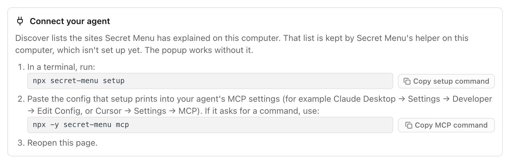

# Command line and details

Run `npx secret-menu <command>` (or `./bin/secret-menu <command>` in a clone). `npx secret-menu --help` lists everything.

## All commands

| Command | What it does |
| --- | --- |
| `launch [--headless] [url...]`, `stop [--force] [--timeout SECONDS] [--kill]`, `status`, `tabs` | Start, stop and inspect the test Chrome (from a clone) |
| `open <url> [--new]`, `reload`, `close [--tab N \| --mine]` | Drive tabs |
| `tools [--tab N] [--json] [--wait-tools]` | List a page's tools, with the same five labels as the popup |
| `form <tool>`, `call <tool> [--arg k=v] [--args JSON] [--yes]` | Inspect and call a tool |
| `explain [--tab N] [--json] [--seed-allowlist]` | Explain a page's tools as abilities |
| `watch [--tab N] [--for SECONDS]` | Stream tools appearing and disappearing |
| `mcp [--read-only] [--allow-tools a,b]` | Run the stdio MCP server |
| `safety [on\|off]` | Show or change the safety setting |
| `allow`, `disallow`, `sites` | Edit the per-site allowlist |
| `approvals`, `approve <id>`, `deny <id>` | Handle pending MCP approvals (when safety is on) |
| `log [--n 20] [--redact]`, `verify` | Read the audit log and check its hash chain |
| `setup [--browser NAME] [--extension-id ID]`, `doctor [--browser NAME]`, `uninstall [--browser NAME]` | Install, check and remove the helper (native messaging host) for your Chrome-family browsers |
| `serve [--port N]` | Serve the test pages on `http://127.0.0.1:8765/` (the 14-tool shop is `/explain.html`) |

Use `--wait-tools` (with `--settle MS` and `--timeout MS`) on pages that register tools a few seconds after loading.

## Setup

```sh
npx secret-menu setup
```

This installs the helper that connects the extension to your computer (Chrome's native messaging host for Secret Menu, `com.secretmenu.bridge`) and a small launcher under `~/.secret-menu`. It's safe to run again; it says what it wrote or left unchanged. If your extension has a different ID, pass it: `npx secret-menu setup --extension-id <32-letter id>` (or set `SECRET_MENU_EXTENSION_ID`).

Setup finds which Chrome-family browsers you have and installs into each one (Google Chrome if it finds none), and prints the browser and folder it wrote to. To pick one, pass `--browser chrome`, `chrome-beta`, `chrome-dev`, `chrome-canary` (macOS only), `chromium` or `all`. You can repeat it or separate names with commas. `doctor` and `uninstall` take the same flag.

Before setup, the extension's Discover and Hand off pages show the same steps:

<p align="center">
  <picture>
    <source media="(prefers-color-scheme: dark)" srcset="screenshots/connect-dark.png">
    
  </picture>
</p>

Then reload the extension (or restart Chrome). On stable Chrome, also turn on `chrome://flags/#enable-webmcp-testing` unless you only use origin-trial sites.

`npx secret-menu doctor` checks it. Each line is `ok` or `FAIL` with a fix: Node version, the helper's manifest, the launcher, the extension ID, and whether the helper is reachable. It exits non-zero when something fails.

`npx secret-menu uninstall` removes only what setup wrote (the helper's manifest in each browser setup used, if it still points at Secret Menu, and the launcher). Your data in `~/.secret-menu` stays.

## What you get from each part

- **Extension only:** an in-page badge on pages that have WebMCP tools, and a toolbar popup that explains them as abilities (safe, changes the view, needs sign-in, changes data, spends money), with the real tool names and a ready-to-copy agent prompt. The popup only reads tools; it never calls them. Before setup, Discover and Hand off show a "Connect your agent" step.
- **Extension plus setup:** your agent sees the same tools and labels you do, and its calls run as you on sites you're signed in to. The Hand off page names the page's real tools in a prompt for your agent, and Discover lists the sites in your local index.
- **The MCP server alone** starts without a browser, but then only `find_sites` and `list_recipes` work, from data already on your machine.

## The extension

- **Badge:** a small in-page badge appears only on pages that have tools. Click it to open the popup, or press × to dismiss it.
- **Popup:** each ability shows a title and a label. Expand a row to see the full title, its tools, notes and a ready-to-copy agent prompt. **Re-check** reads the tools again. The popup is read-only and never calls page tools.
- **Before setup:** the extension works on its own; Discover and Hand off show a "Connect your agent" step with `npx secret-menu setup`.
- **Hand off:** builds an agent prompt from the page's real tools, grouped by what they let you do. Changing data and spending money stay off unless you switch them on. "Run in agent" isn't built yet, so copy the prompt into an agent that has Secret Menu connected.
- **Discover:** lists the sites in your local index.
- **Theme:** one button cycles Light, Dark and System.

## The test Chrome

From a source checkout you can run Secret Menu in its own Chrome for Testing (Apple Silicon Mac only), with the WebMCP flag on and its own profile, never your everyday Chrome. `launch` only works from a clone; `serve` also works from the npm package.

```sh
npx @puppeteer/browsers install chrome@156 --path "$HOME/.secret-menu/browsers"
./bin/secret-menu serve                           # test pages on http://127.0.0.1:8765/ (busy port? add --port 8766)
```

In a second terminal:

```sh
./bin/secret-menu launch http://127.0.0.1:8765/explain.html
./bin/secret-menu tabs                            # tab ids
./bin/secret-menu tools                           # tools on the active tab
./bin/secret-menu explain --tab <id>              # what those tools let you do
./bin/secret-menu call get_store_hours            # call one
./bin/secret-menu stop
```

The test shop at `/explain.html` has 14 fake tools; the plain test page at `/` has 3.

## Tabs Secret Menu opened

Secret Menu only closes or navigates tabs it opened itself: tabs from `open --new`, `explain <url>`, MCP `open_site`, and the tabs `launch <url...>` opens. `close` and `open` refuse other tabs unless you add `--force` (`reload` reloads whichever tab you point it at). `stop` refuses while the test Chrome has tabs you opened. It lists them so you can decide, and `stop --force` quits anyway.

`stop` sends SIGTERM and waits up to `--timeout` seconds (default 8). It only force-kills Chrome if you pass `--kill`; otherwise a Chrome that is still running is reported and `stop` exits with code 4.

## Configuration

- Data lives in `~/.secret-menu`. Change it with `SECRET_MENU_HOME`.
- `SECRET_MENU_CHROME` overrides Chrome discovery.
- `SECRET_MENU_EXTENSION_ID` sets the extension ID for setup.
- `SECRET_MENU_MCP_READ_ONLY=1` and `SECRET_MENU_MCP_ALLOW_TOOLS=a,b` set MCP read-only mode.
